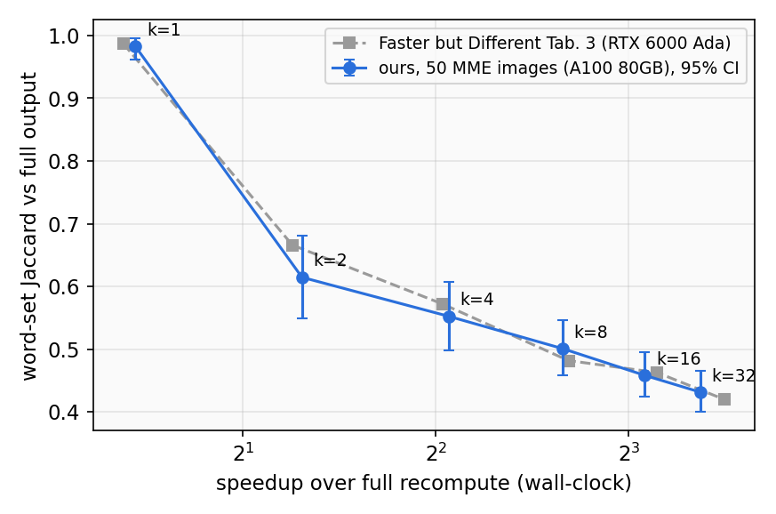

::: {.callout-note}
**Status:** Complete. **G1 accepted as PASS with a recorded deviation** (user decision 2026-10-28).
LLaDA-V · 7 arms · 50 MME images · A100 80GB PCIe for all 350 rows · job 18513394, ~2.9 h wall
(preempted once at 270 rows, resumed by requeue without duplicates).
:::

---

## What

- Runs full recompute and fixed intervals k ∈ {1, 2, 4, 8, 16, 32} through the unified loop (Exp 2).
- Compares speedup and output agreement with Faster but Different (arXiv 2607.29079) Tab. 3.
- The resulting curve is the reference every later refresh policy must beat.

```{dot}
//| label: fig-exp3-what
//| fig-cap: "One campaign, seven arms, compared with the published table"
//| fig-width: 7
//| fig-height: 2.4
digraph G {
  bgcolor="transparent"
  rankdir=LR
  graph [ranksep=0.5, nodesep=0.5]
  node [style=filled, fillcolor="#2c3035", color="#4a9eda",
        fontcolor="#f8f9fa", fontname="Arial", fontsize=11,
        shape=box, width=1.55, height=0.42]
  edge [color="#6c757d", penwidth=1.4]
  D [label="50 MME images", fillcolor="#375a7f"]
  A [label="Full + 6 intervals"]
  {rank=same; P [label="Paper Tab. 3", fillcolor="#375a7f"]}
  F [label="Reference curve", fillcolor="#1a4a3a", color="#00bc8c"]
  D -> A -> F
  P -> F
}
```

---

## Why

- A win over fixed interval only counts if our fixed interval is the published one.
- Different GPU (A100 vs RTX 6000 Ada) and a different 50-image subset could shift both axes.
- The gate compares ratios (speedup, Jaccard), so absolute seconds may differ.

---

## Hypotheses

Thresholds frozen 2026-10-27, before any data (`.claude/research.md`, G1).

| ID | Statement | How to falsify |
|:--:|-----------|----------------|
| **H1** | Speedup over full matches the paper | Any k outside ±20% (relative) of Tab. 3 |
| **H2** | Jaccard vs full matches the paper | Any k outside ±0.05 (absolute) of Tab. 3 |
| **H3** | Both curves are monotone in k | Speedup decreases or Jaccard increases with k anywhere |

---

## How

- Settings read from the paper (Sec. 4, 6.2): prompt "Please describe the image in detail.",
  gen_length = steps = block = 128, **threshold 0.5** for every k, deterministic decoding.
- Full = upstream with `use_fast_dllm=False` (no cache, no threshold, 128 forwards).
- Jaccard = over lowercased alphabetic word sets, against the full output of the same image.
- Data: 50 unique MME images, seed-0 sample of 1187 ([`src/scripts/prepare_mme.py`](../../src/scripts/prepare_mme.py)).
  The paper's 50 are unpublished.
- Campaign [`configs/campaigns/mme_caption_frontier.json`](../../configs/campaigns/mme_caption_frontier.json),
  runner [`src/scripts/run_campaign.py`](../../src/scripts/run_campaign.py), job
  [`slurm/campaign.sbatch`](../../slurm/campaign.sbatch).
- Verdict: [`src/scripts/gate_check.py`](../../src/scripts/gate_check.py) `g1`. 95% CI: bootstrap over images,
  10,000 resamples, seed 0.

---

## Results

Source: [`results/phase1/mme_caption_frontier/g1_summary.json`](../../results/phase1/mme_caption_frontier/g1_summary.json)
and [`analysis_summary.json`](../../results/phase1/mme_caption_frontier/analysis_summary.json).

{width=85%}

| k | speedup (paper) | Jaccard (paper) | Jaccard 95% CI | exact match | r | s / image |
|:---:|:---:|:---:|:---:|:---:|:---:|:---:|
| full | 1.00× | 1.000 | — | — | 1.000 | 65.6 |
| 1 | 1.36× (1.30×) | 0.982 (0.987) | [0.961, 0.995] | 35/50 | 1.000 | 48.3 |
| 2 | 2.47× (2.39×) | **0.615 (0.666)** | [0.550, 0.681] | 6/50 | 0.502 | 26.5 |
| 4 | 4.19× (4.10×) | 0.553 (0.572) | [0.498, 0.607] | 0/50 | 0.253 | 15.7 |
| 8 | 6.31× (6.44×) | 0.501 (0.482) | [0.458, 0.546] | 0/50 | 0.130 | 10.4 |
| 16 | 8.47× (8.85×) | 0.459 (0.463) | [0.424, 0.495] | 0/50 | 0.067 | 7.7 |
| 32 | 10.34× (11.29×) | 0.432 (0.420) | [0.400, 0.466] | 0/50 | 0.035 | 6.3 |

- r = refreshes / forwards. Forwards stay at 111–114 of 128 for every k (threshold 0.5 rarely decodes 2 tokens per step).
- Full recompute 65.6 s / image (paper 71.9 s on RTX 6000 Ada).
- The gate script prints FAIL: interval 2 misses ±0.05 by 0.001.

### Hypothesis assessment

| Hypothesis | Verdict | Evidence |
|:----------:|:-------:|---------|
| **H1** (speedup matches) | **Confirmed** | Largest gap −8.4% at k = 32 (10.34× vs 11.29×) |
| **H2** (Jaccard matches) | **Partial** | 5/6 within ±0.05; k = 2 off by 0.051, paper value inside our CI [0.550, 0.681] |
| **H3** (monotone) | **Confirmed** | Speedup rises and Jaccard falls at every step of k |

The user accepted G1 as PASS with this deviation recorded (2026-10-28). The CI half-width at k = 2 (±0.065)
exceeds the frozen tolerance, so the miss sits inside subset variance.

---

## Insights

- **The reference curve reproduces on our hardware** (6/6 speedups within ±20%, 6/6 paper Jaccards inside our CI).
  - Later policy comparisons use this curve, timed on the same A100 80GB type.
- **r is set by k alone at threshold 0.5** (r = 0.502 at k = 2 → 0.035 at k = 32; forwards 111–114).
  - A policy saves time only by refreshing less; early stopping plays no role on captions.
- **Agreement collapses at the first stale step** (Jaccard 0.982 → 0.615 from k = 1 → 2, then −0.18 over 2 → 32).
  - Obs 1 shows this drop is mostly trajectory divergence, not loss of caption quality.
- **Interval 2 is bimodal per image** (6/50 exact, range 0.24–1.0, sd 0.24).
  - Quality comparisons near k = 2 need paired tests over images, never means alone.

---

## Takeaway

The fixed-interval frontier reproduces within the frozen tolerances except one 0.001 miss inside sampling
variance, so it is frozen as the reference curve. Each step of k buys a predictable speedup, but agreement with
full recompute drops 0.37 at the first stale step. Whether that drop is a quality loss decides where the target
zone lies; Obs 1 examines it.

---

## Connections

- **Exp 2** ([unified-loop identity](exp2_loop_identity.qmd)): the loop used here.
- **Obs 1** ([frontier bad cases](obs1_frontier_bad_cases.qmd)): per-image analysis of these 350 generations.
- **C 1** ([Claims](../claims.qmd#c1)): closes G1; **C 5** ([Claims](../claims.qmd#c5)): the metric question it raises.

---

::: {.grid}
::: {.g-col-4}
[$\leftarrow$ Exp 2 — Unified-loop identity](exp2_loop_identity.qmd)
:::
::: {.g-col-4}
:::
::: {.g-col-4 .text-end}
[Obs 1 — Frontier bad cases $\rightarrow$](obs1_frontier_bad_cases.qmd)
:::
:::
