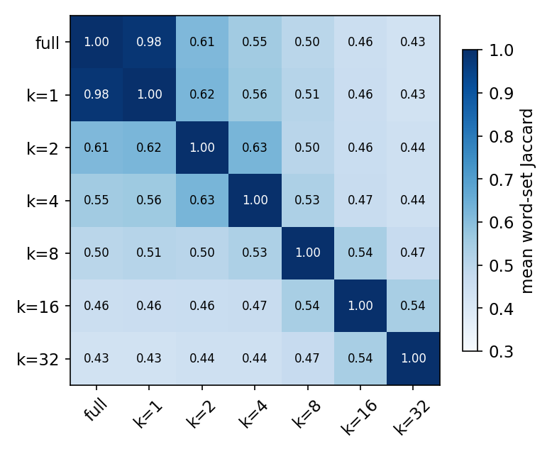
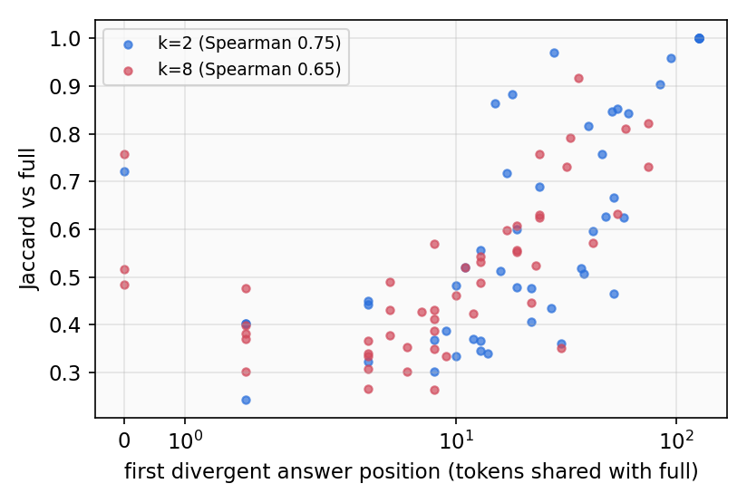
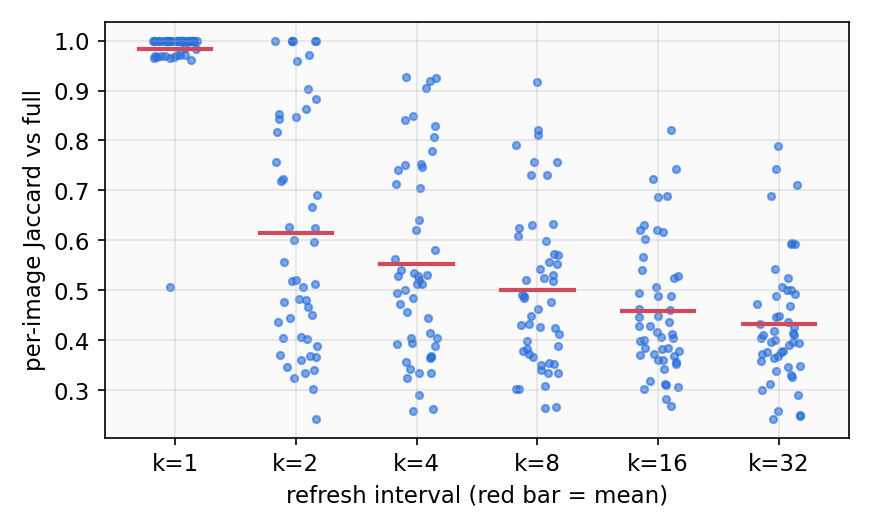

::: {.callout-note}
**Status:** Complete (CPU analysis of the Exp 3 generations, no new GPU run). 350 generations
(7 arms × 50 MME images) · script [`src/scripts/analyze_frontier.py`](../../src/scripts/analyze_frontier.py) ·
summary [`analysis_summary.json`](../../results/phase1/mme_caption_frontier/analysis_summary.json).
Exploratory: the questions below were posed after Exp 3, so they steer the next experiments and are not claims.
:::

---

## What

- Exp 3 found a 0.37 Jaccard drop from k = 1 to k = 2 (0.982 → 0.615).
- This page reads the low-agreement images (bad cases) to find out what that drop means.
- It asks three things: is the cached caption worse, where does it diverge, and which images are fragile.

```{dot}
//| label: fig-obs1-what
//| fig-cap: "From bad cases to candidate refresh levers"
//| fig-width: 7
//| fig-height: 2.8
digraph G {
  bgcolor="transparent"
  rankdir=TB
  graph [ranksep=0.5, nodesep=0.5]
  node [style=filled, fillcolor="#2c3035", color="#4a9eda",
        fontcolor="#f8f9fa", fontname="Arial", fontsize=11,
        shape=box, width=1.55, height=0.42]
  edge [color="#6c757d", penwidth=1.4]
  B [label="Low-Jaccard images", fillcolor="#4a2040", color="#e74c3c"]
  {rank=same; Q1 [label="Worse or different"]; Q2 [label="Where it splits"]; Q3 [label="Which images"]}
  L [label="Refresh levers", fillcolor="#1a4a3a", color="#00bc8c"]
  B -> Q1
  B -> Q2
  B -> Q3
  Q1 -> L
  Q2 -> L
  Q3 -> L
}
```

---

## Why

- The plan's target zone (k = 2–4) was set by Jaccard against full recompute.
- If low Jaccard means "a different but equally good caption", Jaccard cannot rank policies there.
- If divergence starts at a predictable point, a schedule can spend refreshes there first.

**What is stale.** With block = gen_length = 128 the loop recomputes all 128 answer positions at every step.
A non-refresh step reuses only the cached keys and values of the prompt (visual and question tokens, ~3k).
Those prompt states depend on the answer through bidirectional attention. So staleness means: the prompt has
not yet "seen" the answer tokens decoded since the last refresh
([`loop.py`](../../src/methods/refresh/loop.py), non-refresh branch).

---

## Hypotheses

Posed after Exp 3; exploratory.

| ID | Statement | How to falsify |
|:--:|-----------|----------------|
| **H1** | Two cached trajectories agree with each other no more than with full | Jaccard(k = 2, k = 4) exceeds Jaccard(k = 2, full) by > 0.05 |
| **H2** | Low agreement follows from early divergence | Spearman(Jaccard, first divergent position) < 0.5 at k = 2 |
| **H3** | Fragility is a property of the image | Per-image Jaccard ranks correlate < 0.3 across cached k |
| **H4** | Prompt length explains fragility | \|Spearman(Jaccard, N)\| < 0.2 rejects it |

---

## How

- Inputs: the Exp 3 generations (`/scratch/<account>/outputs/dmllm_refresh/mme_caption_frontier/generations.jsonl`).
- First divergent position = number of leading answer tokens identical to the full output.
- Cross-arm agreement = mean word-set Jaccard between every pair of the 7 arms.
- Visual check: the 4 lowest-Jaccard images at k = 2, read against the image by one reader (Claude),
  qualitative only.

---

## Results

### Any two different trajectories agree at about 0.5–0.6

{width=70%}

- Jaccard(k = 2, k = 4) = 0.63 vs Jaccard(k = 2, full) = 0.61: Δ = +0.02.
- k = 1 differs from full only by threshold-0.5 parallel decoding (112 vs 128 forwards). Still 15/50 images
  are not identical, and one (`posters/tt0898367`) drops to Jaccard 0.507.
- All 350 outputs run to the 127-token cap, so every caption is cut off, and Jaccard compares cut-off texts.

### Divergence starts in the first few answer tokens

{width=80%}

| k | median first divergent position | share diverging within 16 tokens | Spearman(Jaccard, position) |
|:---:|:---:|:---:|:---:|
| 2 | 22 | 0.40 | 0.75 |
| 4 | 22 | 0.40 | 0.63 |
| 8 | 8.5 | 0.64 | 0.65 |
| 32 | 8.5 | 0.74 | 0.58 |

- At k = 2, 40% of images split off within their first 16 tokens (of 127).

### Fragility is partly an image property, not a length effect

{width=80%}

- Spearman of per-image Jaccard across cached k: 0.50–0.75 for neighbouring k (k = 2 vs 4: 0.50; 8 vs 16: 0.75).
- Spearman(Jaccard at k = 2, prompt length N) = −0.05.
- Category means at k = 2 (few images each): artwork 0.49 (n = 9), celebrity 0.40 (4), scene 0.66 (11),
  landmark 0.75 (9).

### The four worst k = 2 captions, read against the image

| Image | Jaccard | Full recompute says | k = 2 says | Reader verdict |
|---|:---:|---|---|---|
| basketball (`commonsense_reasoning/0015`) | 0.24 | ball "resting on the court" | ball "held by a person's hand" (a hand is visible) | k = 2 more correct |
| jet (`commonsense_reasoning/0049`) | 0.30 | "UNI" on the jet, contrails | star logo, "smoke and fire" (explosions visible) | both valid |
| pizza (`color/000000047112`) | 0.32 | "two glasses of beer" | a beer and a water (correct) | k = 2 more correct |
| relief (`artwork/10970`) | 0.33 | halos (correct), a book (absent) | boy and girl "wearing a hat" (absent) | full slightly better |

- Qualitative, n = 4, one reader: an indication, not a measurement.

### Hypothesis assessment

| Hypothesis | Verdict | Evidence |
|:----------:|:-------:|---------|
| **H1** (cached arms agree no more with each other) | **Confirmed** | 0.63 vs 0.61 (Δ +0.02 < 0.05); diverged captions are different, not jointly drifting |
| **H2** (early divergence → low agreement) | **Confirmed** | Spearman 0.75 at k = 2; median split at token 22 |
| **H3** (fragility is per image) | **Confirmed** | Rank correlation 0.50–0.75 across neighbouring cached k |
| **H4** (prompt length explains it) | **Rejected** | Spearman −0.05 |

---

## Insights

- **Near k = 2, Jaccard vs full measures which trajectory was taken, not caption quality**
  (k = 2 vs k = 4 agree 0.63 ≈ k = 2 vs full 0.61; in 3 of 4 worst cases the k = 2 caption is as good or better).
  - The k = 2–4 "target zone" may not be a quality zone at all. Task accuracy (MathVerse) must set the anchors.
- **Tiny perturbations already flip trajectories** (k = 1 vs full differ only by parallel decoding: 15/50 not identical, one at 0.507).
  - A policy cannot be judged by token identity; agreement metrics need a perturbation floor.
- **The first answer tokens decide the trajectory** (median split at token 22 at k = 2; Spearman 0.75 with final agreement).
  - Lever: spend refreshes on the early steps, where the caption's frame is still being set.
- **Some images are fragile at every k** (rank correlation up to 0.75; not explained by N).
  - Lever: per-sample refresh budget, if a cheap signal predicts fragility.

---

## Takeaway

The bad cases at k = 2 are mostly different captions, not worse ones: two cached arms agree with each other as
little as with full recompute, and in 3 of 4 worst images the cached caption is at least as accurate. Divergence
is decided early and depends on the image. If accuracy confirms this on MathVerse, the room for a better policy
lies at larger k, where quality truly drops, and early-step refresh is the first lever to test.

---

## Connections

- **Exp 3** ([MME frontier](exp3_mme_frontier.qmd)): source of all 350 generations.
- **C 5** ([Claims](../claims.qmd#c5)): Jaccard vs full is not a quality metric near k = 2 (pending, supported here).
- **C 2** ([Claims](../claims.qmd#c2)): early-step concentration is what D3 will test with replacement error.
- **Next**: Exp 4 (MathVerse frontier) and Exp 5 (early-step refresh probe), see the
  [dashboard](overview.qmd).

---

::: {.grid}
::: {.g-col-4}
[$\leftarrow$ Exp 3 — MME frontier](exp3_mme_frontier.qmd)
:::
::: {.g-col-4}
:::
::: {.g-col-4 .text-end}
[Exp 5 — Replacement-error map $\rightarrow$](exp5_replacement_error_map.qmd)
:::
:::
